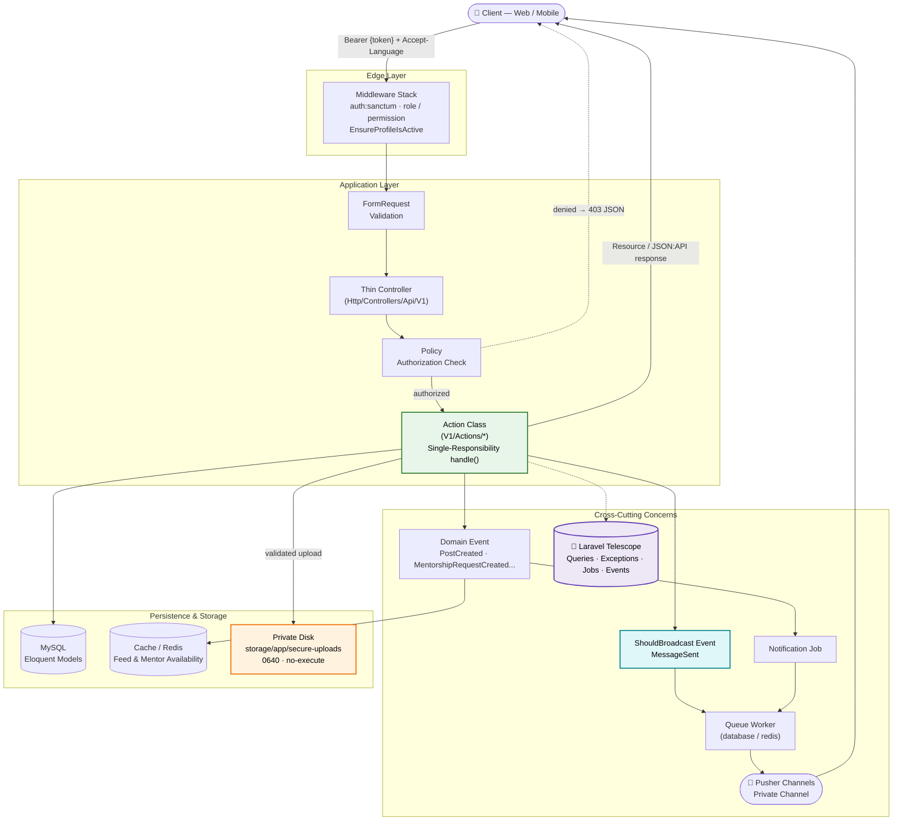

# 🎓 Alumni Network — API V1

<p align="center">
  
  
  
  
  
</p>

<p align="center">
  <em>A Sanctum-secured, role-based backend platform for a university alumni ecosystem — connecting alumni, students, universities, and mentorship programs through a real-time, security-hardened REST API.</em>
</p>

---

## Introduction | مقدمة

<details>
<summary><strong>English</strong></summary>

The day a student graduates, their formal relationship with the university ends — there's no place to return to for career guidance, and no channel to hear about opportunities from fellow alumni once they walk out the gate. A graduate who spent years building a network of peers gradually loses touch with it. **Alumni Network exists to close that gap**: it is a permanent bridge between a university and its graduates — an active professional network connecting alumni to each other and to current students, bringing job opportunities, mentorship, and events into one place. *The university doesn't end at graduation — it becomes a lifelong community.*

**Alumni Network** is the **Laravel 13** backend API that implements this platform. It is built around four roles with clearly separated responsibilities:

| Role | Core capabilities |
| :--- | :--- |
| **Super Admin** | Creates universities in the system and assigns each one's University Admin; views cross-university statistics. |
| **University Admin** | Manages the academic structure (faculties & majors); manually reviews and approves/rejects alumni & student registrations; creates official events and mentorship programs; manages university-posted job listings. |
| **Alumni** | A verified graduate (student ID + graduation year checked by an admin). Builds a professional profile, connects with the network, posts to the Feed, publishes/closes job opportunities, and can act as a **Mentor** or **Mentee** in mentorship programs. |
| **Current Student** | Verified via enrollment ID. Browses alumni profiles and applies to jobs, requests a mentor from alumni in their own faculty — but **cannot** publish job listings or Feed posts. |

Functionally, the platform covers: **university-scoped registration approval**, **alumni/student profiles** (with work experience & a shared skills taxonomy), a **connections graph** (pending → accepted/rejected/blocked, with a 30-day cooldown on re-requesting after rejection), a **cursor-paginated Feed** aggregating posts from connections, university announcements, and fellow alumni, **job listings** with an application pipeline, **university events** with capacity-aware registration and attendance tracking, **mentorship programs** with mentor-capacity enforcement, and **direct messaging** restricted to connected users (with an explicit mentor↔mentee exception).

The codebase is deliberately engineered around **thin controllers**, **single-purpose Action classes**, and a **hardened file-upload pipeline** (see [Key Architectural Decisions](#key-architectural-decisions--القرارات-المعمارية-الأساسية) below), so that every one of these business rules lives in a small, independently testable unit — even as the number of domains (alumni, students, universities, jobs, events, mentorship, messaging, reports…) keeps growing.

</details>

<details>
<summary><strong>العربية</strong></summary>

في اليوم الذي يتخرج فيه الطالب، تنتهي رسمياً علاقته بالجامعة — لا يوجد مكان يعود إليه إذا احتاج توجيهاً مهنياً، ولا قناة يعرف من خلالها الفرص القادمة من زملائه الخريجين بمجرد مغادرته البوابة الجامعية. الخريج الذي أمضى سنوات في بناء شبكة من الزملاء يفقدها تدريجياً. **من هنا وُلدت فكرة Alumni Network**: جسر دائم بين الجامعة وخريجيها — شبكة مهنية نشطة تربط الخريجين بعضهم ببعض وبالطلاب الحاليين، وتُتيح فرص العمل والإرشاد المهني والفعاليات في مكان واحد. *الجامعة لا تنتهي بالتخرج — هي تصبح مجتمعاً يدوم.*

**Alumni Network** هو الـ Backend API المبني بإطار عمل **Laravel 13** الذي يُجسّد هذه الفكرة عملياً. يقوم النظام على أربعة أدوار بمسؤوليات مفصولة بوضوح:

| الدور | أبرز الصلاحيات |
| :--- | :--- |
| **Super Admin** | ينشئ الجامعات في النظام ويُعيّن الـ University Admin لكل جامعة؛ يرى إحصائيات جميع الجامعات. |
| **University Admin** | يدير البنية الأكاديمية للجامعة (الكليات والتخصصات)؛ يعتمد يدوياً طلبات تسجيل الخريجين والطلاب بعد التحقق؛ ينشئ الفعاليات وبرامج الإرشاد الرسمية؛ يدير فرص العمل المنشورة من الجامعة. |
| **Alumni** | خريج موثّق (يُقدّم رقم هويته الجامعية وسنة تخرجه للتحقق). يبني ملفه المهني، يتواصل مع الشبكة، ينشر في الـ Feed، ينشر/يُلغي فرص عمل، ويشارك في برامج الإرشاد كـ Mentor أو Mentee. |
| **Current Student** | يُقدّم رقم قيده للتحقق من انتسابه للجامعة. يتصفح ملفات الخريجين ويتقدم لفرص العمل، ويطلب Mentor من الخريجين في تخصصه — لكنه **لا يستطيع** نشر فرص عمل أو منشورات في الـ Feed. |

على مستوى الوظائف، يغطي النظام: **موافقة تسجيل مقيّدة بكل جامعة**، **ملفات الخريجين والطلاب** (مع تجارب العمل وقائمة مهارات موحّدة)، **شبكة اتصالات** (معلّق ← مقبول/مرفوض/محظور، مع فترة انتظار 30 يوماً قبل إعادة إرسال طلب مرفوض)، **Feed مرتّب زمنياً وقائم على Cursor Pagination** يجمع منشورات المتواصلين وإعلانات الجامعة ومنشورات خريجي نفس الجامعة، **فرص عمل** بدورة تقديم كاملة، **فعاليات جامعية** بتسجيل مقيّد بالسعة وتتبع حضور فعلي، **برامج إرشاد** بحدّ أقصى لعدد المتدربين لكل مرشد، و**مراسلة مباشرة** مقيّدة بالمتواصلين (مع استثناء صريح بين المرشد والمتدرب).

تم بناء الكود البرمجي عن قصد حول مبدأ **المتحكمات النحيفة (Thin Controllers)**، وفئات **أفعال (Actions) أحادية المسؤولية**، و**خط أنابيب رفع ملفات محصّن أمنياً** (انظر [القرارات المعمارية الأساسية](#key-architectural-decisions--القرارات-المعمارية-الأساسية) أدناه)، بحيث تعيش كل قاعدة من قواعد العمل هذه داخل وحدة صغيرة وقابلة للاختبار بشكل مستقل — حتى مع استمرار نمو عدد النطاقات (خريجون، طلاب، جامعات، وظائف، فعاليات، إرشاد أكاديمي، مراسلة، تقارير...).

</details>

---

## Key Architectural Decisions | القرارات المعمارية الأساسية

The four pillars below explain **why** the system is built the way it is, not just **what** it contains.

### 1. Action Pattern — Single-Responsibility Business Logic | نمط الأفعال (Action Pattern)

<details>
<summary><strong>English</strong></summary>

Instead of routing business logic through bloated Controllers or a monolithic Service Layer shared across unrelated concerns, every use case in `app/V1/Actions/` is its own invokable class with a single public `handle()` method — e.g. `CreateMentorshipRequestAction`, `RegisterForEvent`, `ApproveRegistrationAction`. The project currently ships **80+ Action classes across 20 domains** (Alumni Profile, Connections, Jobs, Mentorship, Messages, Reports, University Admin, and more).

**Why this matters:**
- **SRP compliance (SOLID):** each Action does exactly one thing — a Controller method almost never exceeds a few lines, since it just validates the request (via a dedicated `FormRequest`), resolves the Action from the container, and returns a Resource.
- **Testability:** Actions are plain, dependency-injected classes with no HTTP context baked in — they can be unit-tested by calling `handle()` directly, with no need to boot a fake request/response cycle.
- **Reusability across modules:** the same Action can be called from an HTTP controller today and from a console command, a queued job, or another Action tomorrow, without duplicating logic.
- **Predictable code navigation:** because Actions are named after the exact use case they implement (verb + domain noun), any engineer can locate the logic for "reject a mentorship request" without reading through a 500-line `MentorshipController`.

</details>

<details>
<summary><strong>العربية</strong></summary>

بدلاً من تمرير منطق العمل عبر متحكمات (Controllers) متضخمة أو طبقة خدمات (Service Layer) ضخمة ومشتركة بين مهام غير مترابطة، كل حالة استخدام (Use Case) داخل `app/V1/Actions/` هي فئة مستقلة تُستدعى عبر ميثود عام واحد اسمه `handle()` — مثل `CreateMentorshipRequestAction` و `RegisterForEvent` و `ApproveRegistrationAction`. يحتوي المشروع حالياً على **أكثر من 80 فئة Action موزعة على 20 نطاقاً عملياً** (ملفات الخريجين، الاتصالات، الوظائف، الإرشاد الأكاديمي، الرسائل، التقارير، إدارة الجامعات، وغيرها).

**لماذا هذا القرار مهم:**
- **الالتزام بمبدأ SRP (من مبادئ SOLID):** كل Action يقوم بمهمة واحدة فقط — ميثود الكونترولر لا يتجاوز عادة بضعة أسطر، لأنه فقط يتحقق من صحة الطلب (عبر `FormRequest` مخصص)، ثم يستدعي الـ Action من الحاوية (Container)، ويعيد الاستجابة عبر Resource.
- **سهولة الاختبار (Testability):** الأكشنز عبارة عن فئات عادية تُحقن فيها التبعيات (Dependency Injection) دون أي ارتباط بسياق HTTP، مما يسمح باختبارها بشكل مباشر عبر استدعاء `handle()` دون الحاجة لمحاكاة دورة كاملة لطلب واستجابة.
- **إعادة الاستخدام عبر الموديولات:** يمكن استدعاء نفس الـ Action من متحكم HTTP اليوم، ومن أمر Console أو Job مُجدول أو Action آخر غداً، دون تكرار المنطق.
- **سهولة التنقل داخل الكود:** بما أن كل Action يحمل اسماً يعبّر عن حالة الاستخدام بدقة (فعل + اسم النطاق)، يستطيع أي مطور إيجاد منطق "رفض طلب إرشاد أكاديمي" دون قراءة كونترولر مكوّن من 500 سطر.

</details>

---

### 2. Observability via Laravel Telescope | المراقبة عبر Laravel Telescope

<details>
<summary><strong>English</strong></summary>

`laravel/telescope` is wired in as a development dependency and gated behind an explicit `viewTelescope` **Gate** (email allow-list, see `TelescopeServiceProvider`), so it can safely stay reachable in a protected/staging environment, not just `local`.

**What it's used for:**
- **N+1 query detection:** since `Model::preventLazyLoading()` is enabled globally (`AppServiceProvider::boot()`), any accidental N+1 access throws immediately in non-production, and Telescope's **Queries** panel gives a full, timed breakdown of every SQL statement per request to catch it before it does.
- **Exception visibility:** every reportable exception is captured with full context, which matters most on an API where clients only ever see a generic localized JSON error envelope (see the centralized `withExceptions()` handler in `bootstrap/app.php`).
- **Scheduled tasks & failed jobs:** the notification pipeline (job dispatch for mentorship/connection/event notifications) is entirely queue-driven — Telescope's **Jobs** and **Schedule** panels are what make silent queue failures visible instead of invisible.
- **Realtime broadcast events:** Telescope's **Events** panel surfaces every `event()` dispatch, including `MessageSent`, `PostCreated`, `MentorshipRequestCreated`, and `MentorshipRequestStatusUpdated` — useful for confirming a broadcast actually fired without needing a connected WebSocket client.
- **Noise control in non-local environments:** the `Telescope::filter()` closure only records *everything* when `APP_ENV=local`; elsewhere it narrows down to reportable exceptions, failed requests, failed jobs, scheduled tasks, and explicitly tagged entries — keeping the `telescope_entries` table lean in a shared environment.

</details>

<details>
<summary><strong>العربية</strong></summary>

تم دمج `laravel/telescope` كاعتمادية تطوير (Dev Dependency)، ومحمي عبر **Gate** صريح باسم `viewTelescope` (قائمة بريد إلكتروني مسموح بها، انظر `TelescopeServiceProvider`)، بحيث يمكن إبقاءه متاحاً بأمان في بيئة محمية أو staging وليس فقط في `local`.

**استخدامات Telescope في المشروع:**
- **اكتشاف مشكلة N+1:** بما أن `Model::preventLazyLoading()` مفعّل بشكل عام (`AppServiceProvider::boot()`)، فإن أي وصول عرضي بنمط N+1 يرمي استثناءً فورياً خارج بيئة الإنتاج، وتقدم لوحة **Queries** في Telescope تفصيلاً زمنياً كاملاً لكل استعلام SQL في كل طلب لالتقاط المشكلة قبل وقوعها فعلياً في الإنتاج.
- **رصد الاستثناءات:** يتم التقاط كل استثناء قابل للتقرير مع سياقه الكامل، وهذا مهم بشكل خاص في API حيث لا يرى العميل سوى رسالة خطأ JSON عامة ومترجمة (انظر معالج `withExceptions()` المركزي في `bootstrap/app.php`).
- **المهام المجدولة والمهام الفاشلة:** خط أنابيب الإشعارات (إرسال Jobs لإشعارات الإرشاد الأكاديمي والاتصالات والفعاليات) مبني بالكامل على نظام الطوابير (Queues) — لوحتا **Jobs** و **Schedule** في Telescope هما ما يكشفان فشل الطابير الصامت بدلاً من أن يمر دون ملاحظة.
- **أحداث البث الفوري (Realtime):** تُظهر لوحة **Events** في Telescope كل عملية `event()` تم إطلاقها، بما فيها `MessageSent` و `PostCreated` و `MentorshipRequestCreated` و `MentorshipRequestStatusUpdated` — مفيدة للتأكد من إطلاق حدث البث فعلياً دون الحاجة لعميل WebSocket متصل.
- **التحكم بالضجيج خارج البيئة المحلية:** دالة `Telescope::filter()` تسجّل *كل شيء* فقط عندما تكون `APP_ENV=local`؛ أما في البيئات الأخرى فيقتصر التسجيل على الاستثناءات القابلة للتقرير، والطلبات الفاشلة، والمهام الفاشلة، والمهام المجدولة، والإدخالات الموسومة صراحةً — للحفاظ على جدول `telescope_entries` خفيفاً في بيئة مشتركة.

</details>

---

### 3. Realtime Messaging Engine | محرك المراسلة الفورية

<details>
<summary><strong>English</strong></summary>

The realtime layer is built on Laravel's native **Event Broadcasting** contract (`ShouldBroadcast`) with **Pusher Channels** (`pusher/pusher-php-server`) as the broadcaster, and **Redis** (`predis/predis`) available as the queue/cache backend for horizontal scaling.

**How it works:**
- **`MessageSent`** is the canonical realtime event: it implements `ShouldBroadcast` and is pushed on a **private channel** scoped to the conversation (`PrivateChannel('conversation.{conversationId}')`). Channel authorization lives in `routes/channels.php` and strictly checks that the requesting user is one of the conversation's two participants — no user can ever subscribe to a conversation they aren't part of.
- **Trimmed payloads:** `broadcastWith()` sends only the fields the frontend actually needs (id, content, sender, timestamp) instead of serializing the full `Message` model with its relations, keeping the socket payload small.
- **Not every domain event broadcasts to the browser.** Events like `PostCreated`, `MentorshipRequestCreated`, and `MentorshipRequestStatusUpdated` are plain server-side Laravel events (no `ShouldBroadcast`) — they drive internal **Listeners** such as `InvalidateFeedCacheForConnections` and `ClearAvailableMentorsCache`, keeping cached feed/availability data consistent without pushing anything to a client socket.
- **Queues decouple delivery from the request cycle:** because `MessageSent implements ShouldBroadcast` (not `ShouldBroadcastNow`), Laravel automatically pushes the broadcast job onto the queue — the HTTP response for "send message" returns immediately, and the actual Pusher push happens asynchronously via a queue worker (`php artisan queue:listen`), so a slow or momentarily unavailable broadcaster never blocks the API.
- **Async notification jobs follow the same philosophy:** connection-accepted, mentorship-status, and event-reminder notifications are all dispatched through dedicated `Job` classes (`app/Jobs/`) rather than sent inline, for the same reason — notification delivery should never hold up the request/response cycle.

</details>

<details>
<summary><strong>العربية</strong></summary>

طبقة الأحداث الفورية مبنية على عقد **Event Broadcasting** الأصلي في Laravel (`ShouldBroadcast`) باستخدام **Pusher Channels** (`pusher/pusher-php-server`) كمزود بث، مع توفر **Redis** (`predis/predis`) كواجهة خلفية للطوابير والكاش لدعم التوسع الأفقي.

**آلية العمل:**
- **`MessageSent`** هو الحدث الفوري الأساسي: ينفذ واجهة `ShouldBroadcast` ويُبث على **قناة خاصة (Private Channel)** مرتبطة بالمحادثة تحديداً (`PrivateChannel('conversation.{conversationId}')`). صلاحية الاشتراك بالقناة معرّفة في `routes/channels.php` وتتحقق بدقة من أن المستخدم الطالب هو أحد طرفي المحادثة فعلياً — لا يمكن لأي مستخدم الاشتراك بمحادثة لا ينتمي إليها.
- **حمولة بيانات مختصرة:** دالة `broadcastWith()` ترسل فقط الحقول التي تحتاجها الواجهة الأمامية فعلياً (المعرف، المحتوى، المرسل، الطابع الزمني) بدلاً من تسلسل نموذج `Message` بالكامل مع علاقاته، مما يبقي حجم حمولة الـ Socket صغيراً.
- **ليست كل الأحداث الداخلية تُبث للمتصفح.** أحداث مثل `PostCreated` و `MentorshipRequestCreated` و `MentorshipRequestStatusUpdated` هي أحداث Laravel داخلية عادية (لا تنفذ `ShouldBroadcast`) — تُستخدم لتشغيل **Listeners** داخلية مثل `InvalidateFeedCacheForConnections` و `ClearAvailableMentorsCache`، للحفاظ على اتساق بيانات الخلاصة (Feed) والتوفر المخزنة مؤقتاً دون بث أي شيء لعميل متصل.
- **الطوابير تفصل التسليم عن دورة الطلب:** بما أن `MessageSent` ينفذ `ShouldBroadcast` (وليس `ShouldBroadcastNow`)، فإن Laravel يضع مهمة البث تلقائياً في الطابور — استجابة HTTP الخاصة بـ"إرسال رسالة" تعود فوراً، بينما يحدث البث الفعلي عبر Pusher بشكل غير متزامن من خلال عامل طابور (`php artisan queue:listen`)، بحيث لا يؤدي أي بطء أو تعطل مؤقت في مزود البث إلى تعطيل الـ API.
- **مهام الإشعارات غير المتزامنة تتبع نفس الفلسفة:** إشعارات قبول الاتصال، وحالة الإرشاد الأكاديمي، وتذكير الفعاليات تُرسل جميعها عبر فئات `Job` مخصصة (`app/Jobs/`) بدلاً من إرسالها بشكل مباشر ومتزامن، لنفس السبب — تسليم الإشعارات لا يجب أن يوقف دورة الطلب/الاستجابة أبداً.

</details>

---

### 4. Attachment & File Security Architecture | معمارية أمن المرفقات

<details>
<summary><strong>English</strong></summary>

Every uploaded file goes through a dedicated three-layer pipeline in `app/Services/` behind two contracts in `app/Contracts/AttachmentSecurity/` (`FileValidatorInterface`, `SecureFileStorageInterface`), bound via the container in `AppServiceProvider` for full dependency inversion and testability.

**a) Private storage over public disk.** Validated attachments are moved out of `getRealPath()`'s temp location into `storage/app/secure-uploads/user_{id}/{Y}/{m}/{d}/`, a per-user, date-partitioned tree that lives **outside the public webroot** by default — nothing here is directly reachable by a guessable URL the way `storage/app/public` would be. Stored files are `chmod`'d to `0640` (owner/group read-write, **zero execute permission for anyone**), so even a file that somehow slipped past validation can never be executed as a script.

**b) Ownership-scoped, filename-format-locked retrieval.** `SecureFileStorageService::getSecurePath()` refuses to resolve *anything* that doesn't match the exact generated-filename regex (`timestamp_hex.ext`) and only ever searches inside the requesting user's own directory tree — a mismatch returns `null` rather than a distinguishing error, closing off IDOR-style enumeration. This ownership-aware resolution is exactly the pattern needed to safely front the storage with **Laravel's native temporary signed URLs**: because the real path is never derivable from the outside, a short-lived signed download link (`URL::temporarySignedRoute()`) can be issued per request without ever exposing a permanent or predictable public path to the underlying file.

**c) Content-verified MIME/extension validation.** `FileValidatorService` never trusts the client-supplied MIME type or the file's extension. Its validation order is: upload-transfer integrity → size bounds (5MB cap) → **content-based MIME detection** (`finfo`/`getimagesize`/`mime_content_type`, in that order of reliability) → strict allowlist check → **extension-vs-detected-MIME consistency** (blocks the classic `shell.php.jpg` double-extension trick) → **magic-byte header verification** for images (JPEG `FFD8FF`, PNG signature, GIF87a/89a, WEBP RIFF/WEBP markers) and a `%PDF-` signature check for PDFs → null-byte and embedded `<?php` / `<script>` / `javascript:` pattern rejection for plaintext uploads. Only after every check passes is a cryptographically random filename generated (`random_bytes(16)` hex + timestamp), completely discarding the client-supplied original name — this is the layer that closes off RCE-via-upload and polyglot-file attacks before a single byte reaches permanent storage.

</details>

<details>
<summary><strong>العربية</strong></summary>

كل ملف يتم رفعه يمر عبر خط أنابيب من ثلاث طبقات داخل `app/Services/`، خلف عقدين في `app/Contracts/AttachmentSecurity/` (`FileValidatorInterface` و `SecureFileStorageInterface`)، مربوطين عبر الحاوية (Container) داخل `AppServiceProvider` لتحقيق مبدأ Dependency Inversion وسهولة الاختبار الكاملة.

**أ) تخزين خاص بدلاً من قرص عام (Private Disks vs Public Storage).** المرفقات التي اجتازت التحقق يتم نقلها من الموقع المؤقت (`getRealPath()`) إلى `storage/app/secure-uploads/user_{id}/{Y}/{m}/{d}/`، وهي شجرة مجلدات مقسّمة حسب المستخدم والتاريخ وتقع **خارج جذر الموقع العام (Public Webroot)** افتراضياً — لا شيء هنا يمكن الوصول إليه مباشرة عبر رابط قابل للتخمين كما هو الحال في `storage/app/public`. يتم ضبط صلاحيات الملفات المخزنة على `0640` (قراءة وكتابة للمالك والمجموعة فقط، **صفر صلاحية تنفيذ لأي أحد**)، بحيث لا يمكن تنفيذ أي ملف تسلّل عبر التحقق كسكربت مطلقاً.

**ب) استرجاع مقيّد بالملكية وصيغة اسم الملف.** دالة `SecureFileStorageService::getSecurePath()` ترفض حل أي مسار لا يطابق تماماً صيغة اسم الملف المولّد تلقائياً (`timestamp_hex.ext`)، ولا تبحث إلا داخل شجرة مجلدات المستخدم الطالب نفسه — أي عدم تطابق يُعيد `null` بدلاً من رسالة خطأ مميزة، مما يغلق الباب أمام هجمات تعداد نمط IDOR. آلية الاسترجاع الواعية بالملكية هذه هي بالضبط النمط اللازم لدمج **نظام Laravel الأصلي للروابط الموقّعة المؤقتة (Temporary Signed URLs)** بأمان: بما أن المسار الحقيقي غير قابل للاشتقاق من الخارج، يمكن إصدار رابط تحميل موقّع محدود الصلاحية (`URL::temporarySignedRoute()`) لكل طلب دون كشف مسار دائم أو قابل للتخمين للملف الفعلي على القرص.

**ج) تحقق من نوع الملف الفعلي (MIME/Extension) قائم على المحتوى.** لا تثق `FileValidatorService` أبداً بنوع MIME أو امتداد الملف القادمين من العميل. ترتيب التحقق هو: سلامة نقل الرفع ← حدود الحجم (سقف 5 ميغابايت) ← **الكشف عن نوع MIME الحقيقي بناءً على المحتوى** (`finfo`/`getimagesize`/`mime_content_type`، بهذا الترتيب من حيث الموثوقية) ← التحقق من قائمة مسموحة صارمة ← **التحقق من تطابق الامتداد مع نوع MIME المكتشف** (يمنع حيلة الامتداد المزدوج الشهيرة `shell.php.jpg`) ← **التحقق من التوقيع الثنائي (Magic Bytes)** للصور (JPEG `FFD8FF`، توقيع PNG، GIF87a/89a، علامات WEBP RIFF/WEBP) والتحقق من توقيع `%PDF-` لملفات PDF ← رفض البايتات الفارغة (Null Bytes) وأنماط `<?php` / `<script>` / `javascript:` المضمّنة في الملفات النصية. فقط بعد اجتياز كل هذه الفحوصات يتم توليد اسم ملف عشوائي مشفّر (`random_bytes(16)` بصيغة hex مع طابع زمني)، مع تجاهل الاسم الأصلي القادم من العميل بالكامل — هذه هي الطبقة التي تغلق الباب أمام هجمات RCE عبر الرفع وملفات الـ Polyglot قبل وصول أي بايت واحد إلى التخزين الدائم.

</details>

---

## System Architecture Diagram | المخطط الهندسي للنظام



---

## Database Schema (ERD) | مخطط قاعدة البيانات

<details>
<summary><strong>English</strong></summary>

The full entity-relationship diagram for the schema (users, universities, faculties/majors, alumni & student profiles, connections, posts, jobs, events, mentorship programs & requests, messages, notifications) is checked into the repo root.

> 📌 **ERD:** [ERD_Diagram.pdf](ERD_Diagram.pdf)


</details>

<details>
<summary><strong>العربية</strong></summary>

يتم الاحتفاظ بمخطط العلاقات الكامل لقاعدة البيانات (المستخدمون، الجامعات، الكليات/التخصصات، ملفات الخريجين والطلاب، الاتصالات، المنشورات، الوظائف، الفعاليات، برامج وطلبات الإرشاد، الرسائل، الإشعارات) داخل الريبو مباشرة.

> 📌 **ملف الـ ERD:** [ERD_Diagram.pdf](ERD_Diagram.pdf)

</details>

---

## Directory Structure | هيكلية المجلدات

```text
alumni-network/
├── app/
│   ├── V1/
│   │   └── Actions/                # Single-responsibility use-case classes (80+)
│   │       ├── AlumniProfile/
│   │       ├── Authentication/
│   │       ├── Connection/
│   │       ├── Events/              # Event registration & attendance actions
│   │       ├── Job/
│   │       ├── Messages/
│   │       ├── MentorshipProgram/
│   │       ├── MentorshipRequest/
│   │       ├── Post/
│   │       ├── Reports/
│   │       └── UniversityAdmin/
│   ├── Http/
│   │   ├── Controllers/Api/V1/     # Thin controllers — delegate to Actions
│   │   ├── Requests/                # FormRequest validation, one folder per domain
│   │   ├── Resources/Api/           # API Resource transformers (JSON shaping)
│   │   └── Middleware/              # EnsureProfileIsActive, etc.
│   ├── Events/                      # PostCreated, MessageSent (ShouldBroadcast)...
│   ├── Listeners/                   # ClearAvailableMentorsCache, InvalidateFeedCache...
│   ├── Jobs/                        # Queued notification dispatch
│   ├── Notifications/
│   ├── Mail/
│   ├── Policies/                    # 14 authorization policies
│   ├── Services/                    # FileValidatorService, SecureFileStorageService,
│   │                                 #   UploadFileService, LaravelUniversityContext
│   ├── Contracts/
│   │   └── AttachmentSecurity/      # FileValidatorInterface, SecureFileStorageInterface
│   ├── Builders/                    # Custom Eloquent query builders
│   ├── Enums/                       # MentorshipRequestStatus, PostVisibility, ...
│   ├── Models/
│   └── Providers/                   # AppServiceProvider, TelescopeServiceProvider
├── routes/
│   ├── api.php                      # Loads routes/Api/V1/*.php under prefix "v1"
│   ├── Api/V1/                      # One route file per domain (route splitting)
│   ├── channels.php                 # Private channel authorization (Broadcast::channel)
│   └── web.php
├── storage/
│   └── app/secure-uploads/          # Private, non-public attachment storage
├── tests/
│   ├── Feature/                     # Route-level test suites per domain
│   └── Unit/
└── database/
    ├── migrations/
    ├── factories/
    └── seeders/
```

---

## API Reference | مرجع الـ API

### Global Request Headers | الترويسات القياسية

| Header | Value | Description | الوصف |
| :--- | :--- | :--- | :--- |
| `Accept` | `application/json` | Ensures the API returns JSON instead of an HTML error page. | لضمان استجابة JSON بدلاً من صفحة خطأ HTML. |
| `Authorization` | `Bearer {token}` | Required on every protected route — a Sanctum personal access token. | مطلوب في كل مسار محمي — توكن وصول شخصي عبر Sanctum. |
| `Content-Type` | `application/json` or `multipart/form-data` | JSON for standard payloads; multipart when uploading a file (e.g. profile photo, post image). | JSON للحمولات العادية، ومتعدد الأجزاء عند رفع ملف. |

### Standard Error Envelope | صيغة الأخطاء الموحدة

Centralized in `bootstrap/app.php` via `withExceptions()` — every API exception is normalized before it reaches the client:

| Status | Case | الحالة |
| :--- | :--- | :--- |
| `403` | `AuthorizationException` / Spatie `UnauthorizedException` → `"This action is unauthorized."` | إجراء غير مصرح به |
| `404` | `NotFoundHttpException` → `"The requested resource was not found."` | المورد غير موجود |
| `422` | `FormRequest` validation failure, field-level messages | فشل التحقق من صحة البيانات |

### Authentication Flow | تدفق المصادقة

`POST /api/v1/auth/register` → account created with **pending** status → a university admin (`role:uni_admin`) reviews it via `POST /api/v1/uni_admin/universities/{university}/registrations/{user}/approve` → the user can then `POST /api/v1/auth/login` to receive a Sanctum bearer token.

### Endpoints | نقاط النهاية

All endpoints below are relative to `/api/v1` and require `Authorization: Bearer {token}` unless marked **Public**. This is the as-implemented route list (`routes/Api/V1/*.php`), grouped by domain.

#### 🔐 Authentication | المصادقة

| Method | Endpoint | Description | الوصف | Access |
| :--- | :--- | :--- | :--- | :--- |
| `POST` | `/auth/register` | Register a new account (alumni or student) — created as `pending` | تسجيل حساب جديد بحالة معلّق | Public |
| `POST` | `/auth/login` | Authenticate an approved user, issue a Sanctum token | تسجيل الدخول والحصول على توكن | Public |
| `POST` | `/auth/forgot-password` | Send a password reset link | إرسال رابط استعادة كلمة المرور | Public |
| `POST` | `/auth/reset-password` | Reset password using the reset token | تعيين كلمة مرور جديدة | Public |
| `POST` | `/auth/logout` | Revoke the current access token | إلغاء التوكن الحالي | Auth |
| `GET` | `/auth/me` | Return the authenticated user's data | بيانات المستخدم الحالي | Auth |
| `PUT` | `/auth/change-password` | Change the authenticated user's password | تغيير كلمة المرور | Auth |

#### ✅ Registration Approvals | اعتماد التسجيل

| Method | Endpoint | Description | الوصف | Access |
| :--- | :--- | :--- | :--- | :--- |
| `GET` | `/uni_admin/universities/{university}/pending-registrations` | List pending registrations for a university | طلبات التسجيل المعلّقة | Uni Admin |
| `POST` | `/uni_admin/universities/{university}/registrations/{user}/approve` | Approve a user's registration | اعتماد تسجيل مستخدم | Uni Admin |
| `POST` | `/uni_admin/universities/{university}/registrations/{user}/reject` | Reject a user's registration | رفض تسجيل مستخدم | Uni Admin |

#### 🤝 Connections | الاتصالات

| Method | Endpoint | Description | الوصف | Access |
| :--- | :--- | :--- | :--- | :--- |
| `GET` | `/connections` | List the authenticated user's connections | قائمة اتصالاتي | Auth |
| `GET` | `/connections/pending` | List incoming pending connection requests | الطلبات الواردة المعلّقة | Auth |
| `POST` | `/connections/{user}` | Send a connection request | إرسال طلب اتصال | Auth |
| `POST` | `/connections/{connection}/accept` | Accept a pending request | قبول طلب اتصال | Auth |
| `POST` | `/connections/{connection}/reject` | Reject a pending request | رفض طلب اتصال | Auth |
| `DELETE` | `/connections/{connection}` | Remove an accepted connection | إلغاء اتصال قائم | Auth |
| `POST` | `/connections/{connection}/block` | Block a connection | حظر مستخدم | Auth |

#### 📰 Feed & Posts | الخلاصة والمنشورات

| Method | Endpoint | Description | الوصف | Access |
| :--- | :--- | :--- | :--- | :--- |
| `GET` | `/feed` | Cursor-paginated feed (connections + university announcements + fellow alumni) | الخلاصة المخصصة | Auth |
| `POST` | `/posts` | Create a new post (optional image, 3 visibility levels) | نشر منشور جديد | Auth |
| `GET` | `/posts/{post}` | Get a single post's details | تفاصيل منشور | Auth |
| `PUT` | `/posts/{post}` | Update a post (owner only) | تعديل منشور (صاحبه فقط) | Auth |
| `DELETE` | `/posts/{post}` | Delete a post | حذف منشور | Auth |
| `POST` | `/posts/{post}/comments` | Add a comment (or threaded reply) | إضافة تعليق | Auth |
| `GET` | `/posts/{post}/comments` | List a post's comments | قائمة التعليقات | Auth |
| `DELETE` | `/posts/{post}/comments/{comment}` | Delete a comment | حذف تعليق | Auth |

#### 💼 Job Listings | فرص العمل

| Method | Endpoint | Description | الوصف | Access |
| :--- | :--- | :--- | :--- | :--- |
| `GET` | `/jobs` | List job listings | قائمة فرص العمل | `view-jobs` |
| `POST` | `/jobs` | Publish a job listing | نشر فرصة عمل | `create-job` |
| `GET` | `/jobs/my-applications` | List my own job applications | طلباتي للوظائف | `apply-for-job` |
| `GET` | `/jobs/{jobListing}` | Job listing details | تفاصيل فرصة عمل | `view-jobs` |
| `PUT` | `/jobs/{jobListing}` | Update a job listing | تعديل فرصة عمل | `edit-own-job` |
| `DELETE` | `/jobs/{jobListing}` | Delete a job listing | حذف فرصة عمل | `delete-own-job` \| `delete-any-job` |
| `PATCH` | `/jobs/{jobListing}/close` | Close the application window | إغلاق باب التقديم | `close-job` |
| `POST` | `/jobs/{jobListing}/apply` | Apply to a job listing | التقدم لفرصة عمل | `apply-for-job` |
| `GET` | `/jobs/{jobListing}/applications` | List applicants for a listing | قائمة المتقدمين | `view-job-applications` |
| `PATCH` | `/jobs/{jobListing}/applications/{application}/status` | Update an applicant's status | تحديث حالة متقدم | `update-application-status` |

#### 🎓 Events | الفعاليات

*Nested under `/universities/{university}`; the `event` route binding is scoped to `university`.*

| Method | Endpoint | Description | الوصف | Access |
| :--- | :--- | :--- | :--- | :--- |
| `GET` | `/events` | List a university's events | قائمة الفعاليات | Auth |
| `GET` | `/events/{event}` | Event details | تفاصيل فعالية | Auth |
| `POST` | `/events/{event}/register` | Register for an event | التسجيل بفعالية | Auth |
| `DELETE` | `/events/{event}/register` | Cancel event registration | إلغاء التسجيل | Auth |
| `POST` | `/events` | Create a new event | إنشاء فعالية | Uni Admin |
| `PUT` | `/events/{event}` | Update an event | تعديل فعالية | Uni Admin |
| `GET` | `/events/{event}/registrations` | List an event's registrations | قائمة المسجلين | Uni Admin |
| `POST` | `/events/{event}/attend` | Mark a registrant's attendance | تسجيل الحضور | Uni Admin |

#### 💬 Messages | الرسائل

| Method | Endpoint | Description | الوصف | Access |
| :--- | :--- | :--- | :--- | :--- |
| `POST` | `/messages` | Send a message (implicitly creates the conversation) — broadcasts `MessageSent` on the conversation's private channel | إرسال رسالة (تُنشئ المحادثة ضمنياً) وتُبث فورياً | Auth |
| `GET` | `/conversations/{conversation}/messages` | List a conversation's message history | سجل رسائل محادثة | Auth |

---

## Core Business Workflows | آليات العمل الأساسية

The three walkthroughs below trace a request end-to-end through the Action/Event/Queue layers described above — they're the workflows the delivery spec calls out explicitly.

### 📝 Registration Verification | التحقق من التسجيل

<details>
<summary><strong>English</strong></summary>

1. **Sign-up (`POST /auth/register`).** An alumni submits their university student ID and graduation year; a student submits their enrollment ID. The account is created with profile status **`pending`** — a pending user cannot see any content or interact with anyone (feed, connections, jobs, messages are all blocked until approval).
2. **Manual admin review.** The relevant `University Admin` sees the request in `GET /uni_admin/universities/{university}/pending-registrations` and cross-checks the submitted ID / graduation year / faculty-major against the university's own academic structure (faculties & majors created in step "Academic Structure").
3. **Decision.** The admin calls either:
   - `POST .../registrations/{user}/approve` → `ApproveRegistrationAction` flips the profile to **`active`** and queues a welcome notification.
   - `POST .../registrations/{user}/reject` → the profile is marked **`rejected`**; the user is not deleted, and this is a distinct state from a *connection* rejection (see below).
4. **First login.** Only after approval can the user call `POST /auth/login` to receive a Sanctum bearer token — an account stuck at `pending`/`rejected` cannot authenticate into a usable session.
5. **University scoping carries through.** Because every profile is tied to one `university_id`, an approved alumni/student only ever sees data scoped to their own university (jobs, events, feed, mentorship programs) — enforced at the Policy layer, not just in the UI.

</details>

<details>
<summary><strong>العربية</strong></summary>

1. **التسجيل (`POST /auth/register`).** يقدّم الخريج رقم هويته الجامعية وسنة تخرجه، ويقدّم الطالب رقم قيده. يُنشأ الحساب بحالة **`pending`** — والمستخدم المعلّق لا يرى أي محتوى ولا يتفاعل مع أحد (الـ Feed، الاتصالات، الوظائف، والرسائل كلها محجوبة حتى الاعتماد).
2. **المراجعة اليدوية من الإدمن.** يرى `University Admin` الطلبات عبر `GET /uni_admin/universities/{university}/pending-registrations` ويتحقق من رقم الهوية/سنة التخرج/الكلية والتخصص المُدخلة مقابل البنية الأكاديمية الفعلية للجامعة (الكليات والتخصصات).
3. **القرار.** يستدعي الإدمن أحد المسارين:
   - `POST .../registrations/{user}/approve` → يحوّل `ApproveRegistrationAction` حالة الملف إلى **`active`** ويُضيف إشعار ترحيب إلى الطابور.
   - `POST .../registrations/{user}/reject` → تصبح حالة الملف **`rejected`**؛ لا يُحذف الحساب، وهذه حالة مختلفة عن رفض *طلب اتصال* (انظر أدناه).
4. **أول تسجيل دخول.** فقط بعد الاعتماد يستطيع المستخدم استدعاء `POST /auth/login` للحصول على توكن Sanctum — الحساب العالق على `pending`/`rejected` لا يستطيع الدخول لجلسة فعلية.
5. **النطاق الجامعي يستمر بعد الاعتماد.** بما أن كل ملف مرتبط بـ `university_id` واحد، فإن الخريج/الطالب المعتمد لا يرى إلا بيانات جامعته (الوظائف، الفعاليات، الـ Feed، برامج الإرشاد) — وهذا مفروض على مستوى الـ Policy وليس فقط في الواجهة.

</details>

### 📡 Feed Algorithm | خوارزمية الـ Feed

<details>
<summary><strong>English</strong></summary>

1. **Three sources, merged.** `GET /feed` aggregates posts from three places in a single timeline: (a) posts from the user's accepted **connections**, (b) official **university announcements**, and (c) posts from **fellow alumni of the same university** — even if not connected.
2. **Newest-first, cursor-paginated.** Results are ordered by recency and paginated with a **cursor** (not offset-based `page=`), so a post created between two requests never causes the same item to appear twice or a later one to be skipped — important since the feed is a live-merging query across sources.
3. **Cached per user, 5 minutes.** Each user's computed feed page is cached for 5 minutes to avoid re-running the three-source aggregation on every request.
4. **Event-driven invalidation, not TTL alone.** When a post is created, `PostCreated` fires and the `InvalidateFeedCacheForConnections` listener proactively busts the cache for that author's connections (and, where relevant, fellow alumni) — so a new post shows up immediately for the people it's relevant to, instead of waiting out the 5-minute TTL.
5. **Visibility is enforced at query time.** A post's visibility level (public / connections-only / university-alumni-only) is applied as part of the aggregation query itself, so the cache never has to be built per-viewer-permission — it's filtered correctly before caching.

</details>

<details>
<summary><strong>العربية</strong></summary>

1. **ثلاثة مصادر مدموجة.** يجمع `GET /feed` منشورات من ثلاثة مصادر في تايم لاين واحد: (أ) منشورات **المتواصلين المقبولين**، (ب) **إعلانات الجامعة** الرسمية، (ج) منشورات **خريجي نفس الجامعة** حتى لو لم يكونوا متواصلين.
2. **الأحدث أولاً مع Cursor Pagination.** النتائج مرتبة بالأحدث ومُقسّمة صفحات عبر **Cursor** وليس `page=` (offset)، بحيث لا يظهر منشور جديد أنشئ بين طلبين مرتين ولا يختفي منشور آخر — وهذا مهم لأن الـ Feed هو استعلام دمج حي من عدة مصادر.
3. **كاش لكل مستخدم لمدة 5 دقائق.** تُخزَّن صفحة الـ Feed المحسوبة لكل مستخدم في الكاش لمدة 5 دقائق لتفادي إعادة تنفيذ استعلام الدمج الثلاثي في كل طلب.
4. **إبطال قائم على الأحداث، وليس على الـ TTL فقط.** عند نشر منشور جديد، يُطلَق حدث `PostCreated` ويقوم المستمع (`Listener`) `InvalidateFeedCacheForConnections` بإبطال الكاش فوراً لمتواصلي صاحب المنشور (وخريجي نفس الجامعة عند الاقتضاء) — بحيث يظهر المنشور الجديد فوراً لمن يهمهم دون انتظار انتهاء الـ 5 دقائق.
5. **الرؤية (Visibility) تُطبَّق وقت الاستعلام.** مستوى رؤية المنشور (عام / متواصلون فقط / خريجو الجامعة فقط) يُطبَّق كجزء من استعلام الدمج نفسه، فلا حاجة لبناء كاش مختلف لكل صلاحية مشاهدة — تتم التصفية الصحيحة قبل التخزين المؤقت.

</details>

### 🎓 Mentorship Workflow | آلية الإرشاد المهني (Mentorship)

<details>
<summary><strong>English</strong></summary>

1. **Program setup.** A `University Admin` creates a mentorship program scoped to their university, with a time window and a **mentor capacity** (`mentor_per_mentees_max` — the maximum number of active mentees any one mentor can take on in that program). Programs move through `draft → active → closed`.
2. **Becoming available as a mentor.** An alumni must be **`active`** and must flip `POST /alumni/me/toggle-mentor` (`is_open_to_mentor = true`) to show up in `GET /mentors` — the available-mentors list is cached for 15 minutes and cleared by the `ClearAvailableMentorsCache` listener whenever mentor availability changes.
3. **Sending a request.** A mentee (alumni or student) calls `POST /mentorship-requests` targeting a mentor **in their own faculty only**, with an intro message. A mentee cannot have more than one *active* request in the same program, and requests start at status **`pending`**.
4. **Capacity enforcement on accept.** When the mentor calls `POST /mentorship-requests/{id}/accept`, the Action re-checks the program's `mentor_per_mentees_max` before confirming — a mentor can never accept past their capacity. Once a mentor's active mentee count reaches the cap, they're **automatically marked unavailable** for that specific program (they can still mentor in other programs where they have room).
5. **Auto-created conversation.** On acceptance, `MentorshipRequestStatusUpdated` triggers automatic creation of a direct conversation between mentor and mentee — this is the **explicit exception** to the "messages require an accepted connection" rule, since a mentor/mentee pair is allowed to message each other even if they never separately connected.
6. **Wrap-up.** Either side can later call `POST /mentorship-requests/{id}/complete` to close out the mentorship; a rejected request (`reject`) simply frees up the mentor's remaining capacity for the next incoming request.

</details>

<details>
<summary><strong>العربية</strong></summary>

1. **إنشاء البرنامج.** ينشئ `University Admin` برنامج إرشاد مرتبطاً بجامعته، بفترة زمنية محددة و**سعة قصوى للمرشد** (`mentor_per_mentees_max` — أقصى عدد متدربين نشطين يمكن لأي مرشد أخذهم ضمن هذا البرنامج). يمرّ البرنامج بالحالات `draft → active → closed`.
2. **أن يصبح الخريج متاحاً كمرشد.** يجب أن يكون الخريج بحالة **`active`** وأن يُفعّل `POST /alumni/me/toggle-mentor` (`is_open_to_mentor = true`) ليظهر ضمن `GET /mentors` — قائمة المرشدين المتاحين مخزّنة في كاش لمدة 15 دقيقة ويتم إفراغها عبر المستمع `ClearAvailableMentorsCache` كلما تغيّرت حالة توفر أحد المرشدين.
3. **إرسال الطلب.** يرسل المتدرب (خريج أو طالب) `POST /mentorship-requests` موجّهاً لمرشد **من نفس كليته فقط**، مع رسالة تعريفية. لا يستطيع المتدرب أن يكون لديه أكثر من طلب *نشط* واحد في نفس البرنامج، وتبدأ الطلبات بحالة **`pending`**.
4. **فرض السعة القصوى عند القبول.** عند استدعاء المرشد لـ `POST /mentorship-requests/{id}/accept`، يعيد الـ Action التحقق من `mentor_per_mentees_max` الخاص بالبرنامج قبل التأكيد — لا يمكن للمرشد تجاوز سعته أبداً. عند وصول عدد المتدربين النشطين للمرشد إلى الحد الأقصى، يُعلَّم المرشد **تلقائياً كغير متاح** في ذلك البرنامج تحديداً (ويبقى متاحاً في برامج أخرى لديه فيها سعة متبقية).
5. **إنشاء محادثة تلقائياً.** عند القبول، يُطلق حدث `MentorshipRequestStatusUpdated` إنشاءً تلقائياً لمحادثة مباشرة بين المرشد والمتدرب — وهذا هو **الاستثناء الصريح** لقاعدة "الرسائل تتطلب اتصالاً مقبولاً"، إذ يُسمح لثنائي المرشد/المتدرب بالتراسل حتى لو لم يتواصلا بشكل منفصل عبر شبكة الاتصالات.
6. **الإنهاء.** يستطيع أي من الطرفين لاحقاً استدعاء `POST /mentorship-requests/{id}/complete` لإنهاء الإرشاد؛ أما رفض الطلب (`reject`) فيُحرِّر ببساطة سعة المرشد المتبقية للطلب التالي الوارد.

</details>

---

## Installation & Setup | التثبيت والإعداد

### Prerequisites | المتطلبات

- **PHP >= 8.5** with the `fileinfo` extension enabled (required by the file-security pipeline)
- **Composer 2.x**
- **Redis** (recommended for `QUEUE_CONNECTION` / `CACHE_STORE` in production)
- A **Pusher** account (or a Pusher-protocol-compatible service) for realtime broadcasting

### Steps | الخطوات

```bash
# 1. Clone the repository
git clone https://github.com/khederAlkhateeb/Alumni-Network
cd alumni-network

# 2. Install PHP dependencies
composer install

# 3. Environment setup
cp .env.example .env
php artisan key:generate
# → then configure DB_*, REDIS_*, PUSHER_*, and BROADCAST_CONNECTION in .env

# 4. Run database migrations
php artisan migrate

# 5. (Optional) Seed roles, permissions, and demo data
php artisan db:seed

# 6. Publish & migrate Telescope's own tables (dev/staging only)
php artisan telescope:install
php artisan migrate

```

> `composer run dev` runs `php artisan serve`, `php artisan queue:listen`and `php artisan pail` (live logs)
concurrently — everything needed for local development, including the queue worker that actually delivers realtime broadcasts and notification jobs, in a single command.

### Running the WebSocket-facing broadcaster | تشغيل خادم البث

```bash
# Set BROADCAST_CONNECTION=pusher and fill in PUSHER_APP_* in .env, then
# the queue worker above (php artisan queue:listen) is what pushes
# queued ShouldBroadcast events out to Pusher — no separate process
# is required beyond a running queue worker and valid Pusher credentials.
```

---

## Tech Stack | حزمة التقنيات

| Layer | Technology |
| :--- | :--- |
| Framework | Laravel `^13.8` on PHP `^8.5` |
| Authentication | Laravel Sanctum `^4.0` (Bearer tokens) |
| Authorization | Spatie Laravel Permission `^8.3` (role & permission middleware) + Policies |
| Realtime Broadcasting | Pusher Channels (`pusher/pusher-php-server ^7.2.8`) over queued `ShouldBroadcast` events |
| Queue / Cache Backend | Redis (`predis/predis ^3.5`) — configurable per environment |
| Observability | Laravel Telescope `^5.21` (gated, environment-aware filtering) |
| Testing | Pest `^12.5` — 17 Feature/Unit suites covering routes per domain |

---

## 📚 API Documentation

* **Live API Docs:** [Alumni Network API Documentation](https://nity0i8ngr.apidog.io)

---

## 🙋 My contribution (Hasan Dayoub)

This repository is my fork of the team project [khederAlkhateeb/Alumni-Network](https://github.com/khederAlkhateeb/Alumni-Network). I worked on the `hasan` branch and the feature branches `hasan-feat-events`, `hasan-feat-notifications`, `hasan-feat-managementpassword` and `hasan-feat-testing`.

Merged pull requests in the team repository: [#9](https://github.com/khederAlkhateeb/Alumni-Network/pull/9), [#29](https://github.com/khederAlkhateeb/Alumni-Network/pull/29), [#40](https://github.com/khederAlkhateeb/Alumni-Network/pull/40), [#45](https://github.com/khederAlkhateeb/Alumni-Network/pull/45), [#55](https://github.com/khederAlkhateeb/Alumni-Network/pull/55), [#56](https://github.com/khederAlkhateeb/Alumni-Network/pull/56).

Modules I built:

- **University events:** CRUD, registration and attendance (`Event`, `EventRegistration`, `EventBuilder`, `EventPolicy`), plus event reminders (`EventReminderNotification` and a scheduled console command)
- **Notifications management:** endpoints, queued job and actions
- **Password management:** password reset and change password
- **Tests:** `NotificationManagementTest`, `EventRoutesTest` and `PasswordManagementTest` (Pest feature tests)

## 🌐 Live demo

**API base URL:** https://alumni-network-api-08ia.onrender.com

- **Interactive API docs:** https://alumni-network-api-08ia.onrender.com/docs/api, to try every endpoint in the browser (generated from the code with [Scramble](https://scramble.dedoc.co)). Log in, paste the token as the Bearer token, and send requests.
- Demo accounts (password `password` for all): student `student@alumni.demo`, alumni `alumni@alumni.demo`, university admin `uniadmin@alumni.demo` (Northbridge University, id 1), super admin `admin@alumni.demo`.
- Try my modules: list events with `GET /api/v1/universities/1/events`, register for one, record attendance as the university admin for "Northbridge Hackathon Week" (it is running in the demo), then check `GET /api/v1/notifications`.
- Hosted on Render's free tier with SQLite: the first request after a period of inactivity can take about a minute, and the demo data resets on every restart. Real-time Pusher delivery and emails are turned off in the demo.
